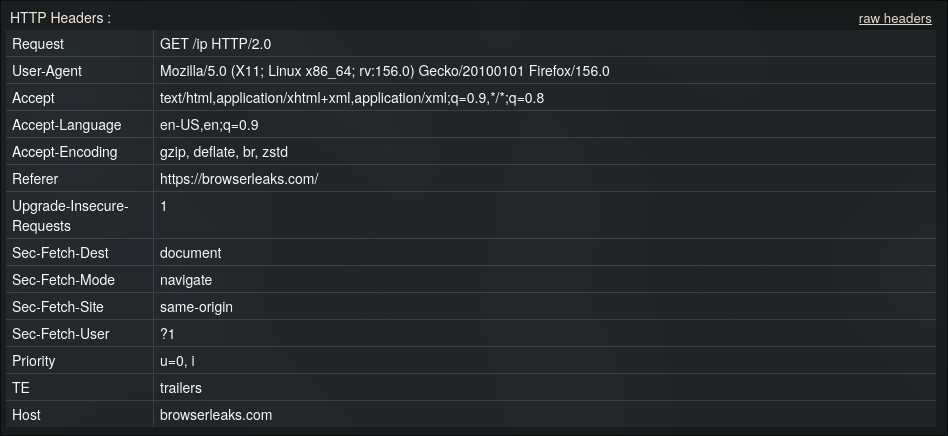
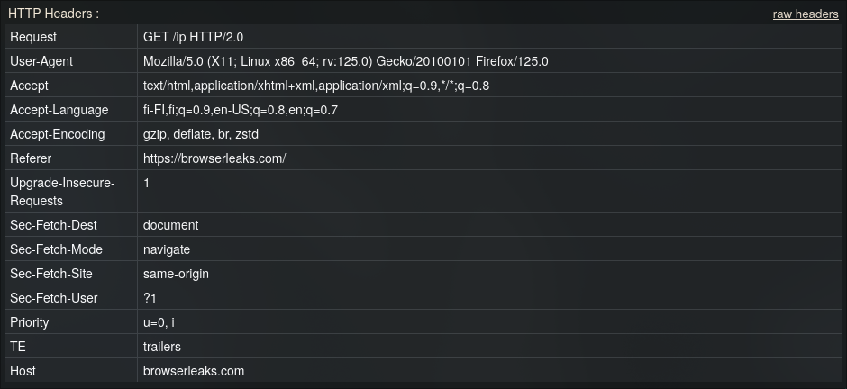
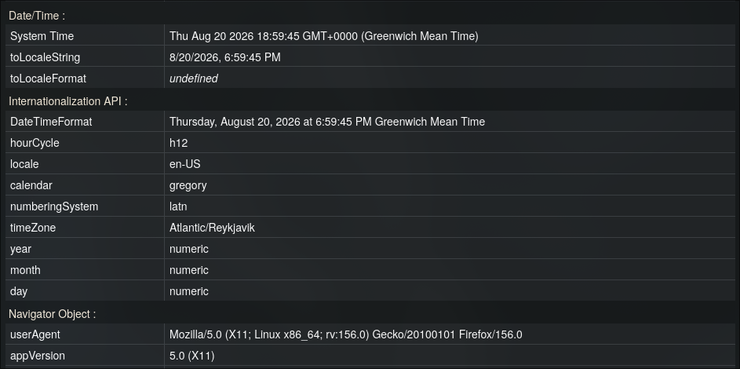
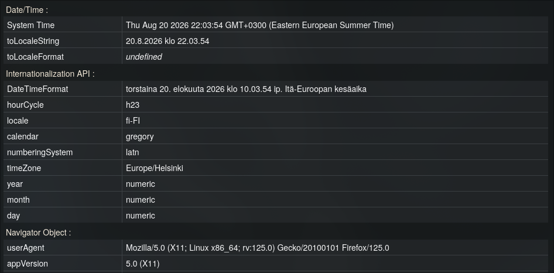
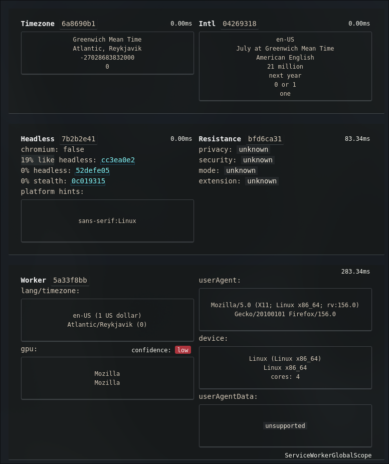
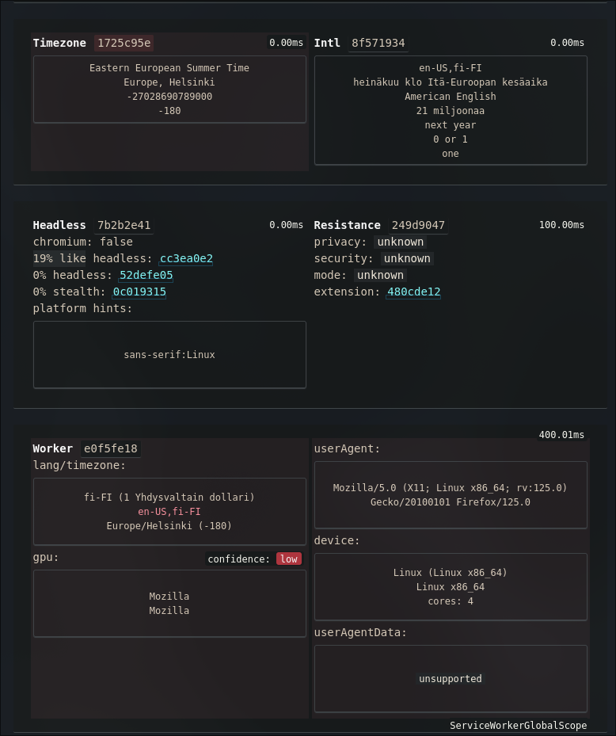
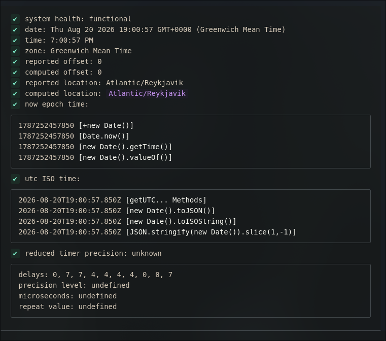
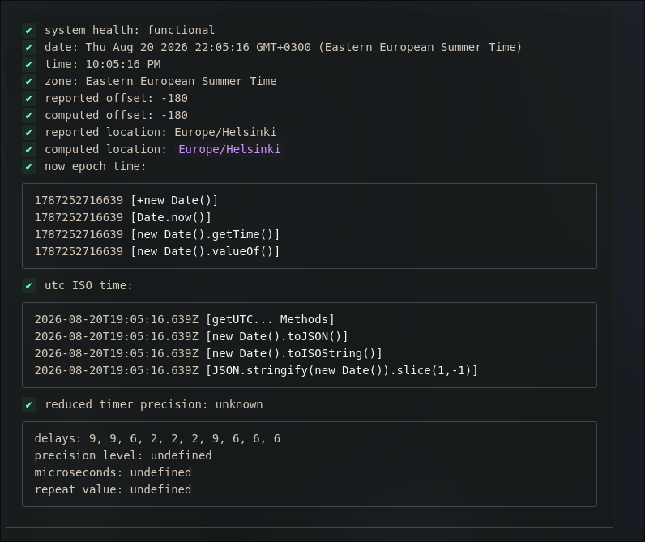
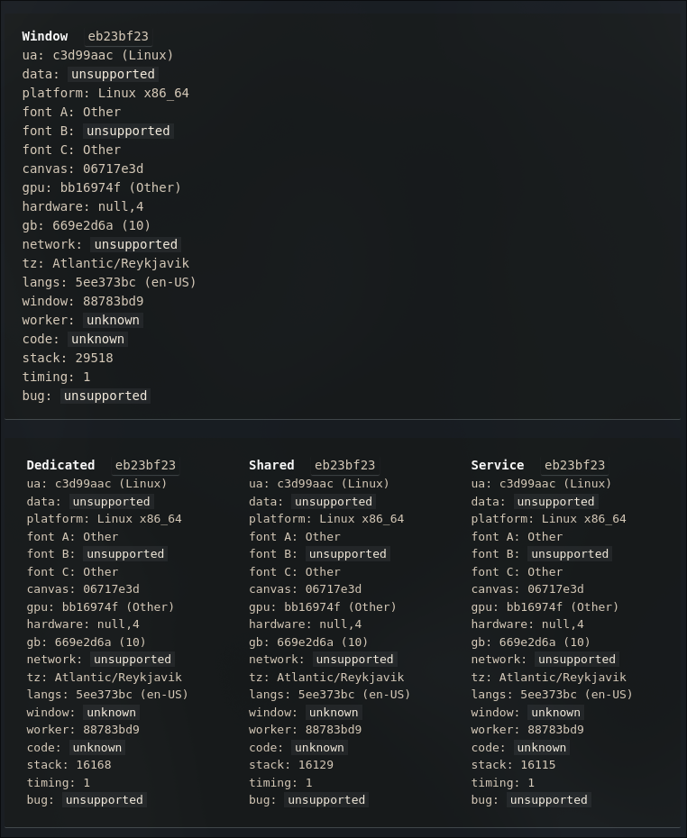
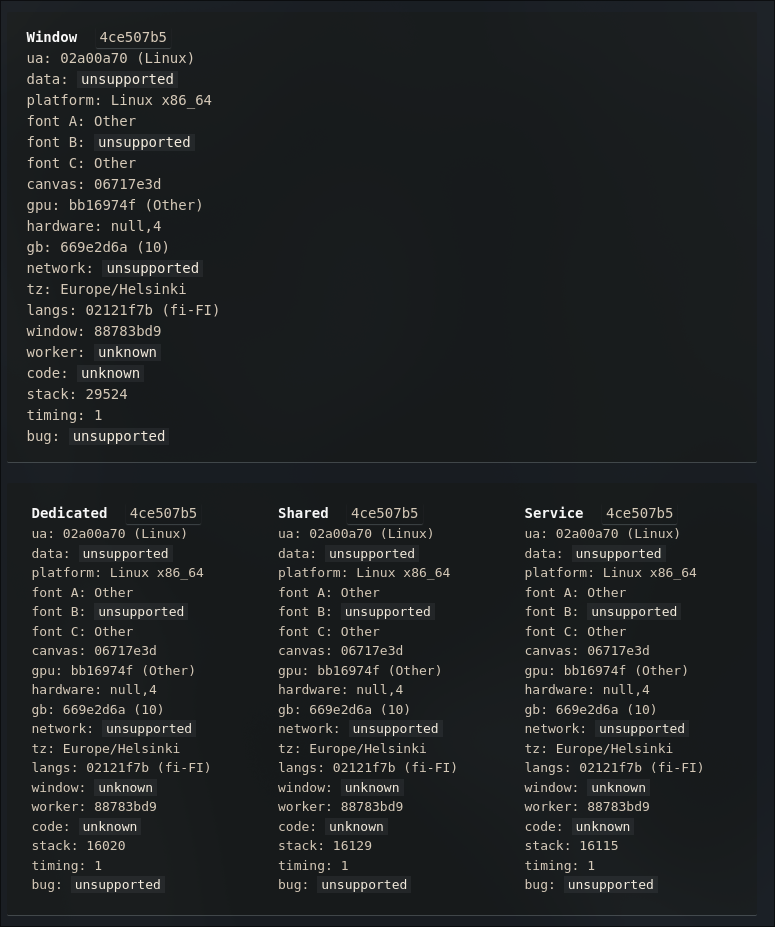

# Timezone Guard

[](https://addons.mozilla.org/addon/timezone-guard/)

*[Читать на русском](ru/README.ru.md)*

A Firefox extension that spoofs the time zone and (optionally) the User-Agent reported by the browser to websites — across all contexts: the main page, iframes (any nesting depth), Dedicated Worker, Shared Worker, and Service Worker.

## Why

Websites infer approximate location and browser characteristics via `Intl.DateTimeFormat`, `Date.prototype.getTimezoneOffset`, `navigator.userAgent`, and similar APIs — and they do this not only in the main window but also inside workers, where ordinary time-zone spoofing extensions usually can't reach. This extension patches all these points consistently, so every context returns the same spoofed values.

## Features

- **Time zone spoofing** — `Intl.DateTimeFormat`, `Date.prototype.getTimezoneOffset`, `toString` / `toDateString` / `toTimeString` / `toLocaleString` / `toLocaleDateString` / `toLocaleTimeString`
- **Optional User-Agent spoofing** — `navigator.userAgent`, `appVersion`, `platform`, `vendor`, `language`, `languages`, `maxTouchPoints`, `oscpu` (Firefox), and related properties
- **HTTP header spoofing** — optionally modifies outgoing `Accept-Language` and `User-Agent` headers to match the selected timezone and browser identifier
- **Site whitelist** — restrict spoofing to the sites you list (one domain per line in the popup, subdomains included); an empty list spoofs everywhere as before. On non-whitelisted sites the environment stays completely native — nothing is wrapped, nothing is modified
- **Full context coverage** — main window, iframe (including nested iframe-within-iframe and `about:blank`/`srcdoc` frames), Dedicated Worker, Shared Worker, Service Worker
- **Consistent locale identity** — the default locale of every Intl API (`DateTimeFormat`, `NumberFormat`, `Collator`, `DisplayNames`, `PluralRules`, `ListFormat`, `RelativeTimeFormat`) resolves to the spoofed timezone's language; the global `Date` object passes native-look checks (`toString`, `name`, `length`)
- **Real system clock untouched** — `Date.now()` and the actual OS clock are not modified; only how the date is *interpreted and displayed* in the chosen time zone is changed
- **Cached formatters** — `Intl.DateTimeFormat` and `Intl.NumberFormat` formatters are cached to avoid timing detection (important against detectors like CreepJS)
- **CSP-safe** — works on sites with strict Content-Security-Policy (Spotify Web Player and similar) via declarative injection through `world: "MAIN"`
- **No enumerable globals** — all shared state lives inside the closure of a single file and is not enumerable from the outside
- **Temporal API support** — patches `Temporal.Now.timeZoneId` and related methods when available
- **Number format spoofing** — `Intl.NumberFormat` and `Number.prototype.toLocaleString` use the spoofed locale

## How it works

### Main page and iframes — `spoof/main.js`

A single content script injected by the browser directly into the page's main world (`world: "MAIN"` in the manifest). This bypasses the page's CSP, since such injection is not treated as code added by the page itself.

- `Intl.DateTimeFormat`, `Intl.NumberFormat`, and `Date.prototype` methods are patched once per window, with cached formatters.
- `navigator.userAgent` and related properties are patched via `Object.defineProperty` on `Navigator.prototype`.
- All patched functions are masked as `[native code]` via a custom `toString` wrapper.
- **iframe**: instead of `MutationObserver` (which is always asynchronous), the getter `contentWindow` / `contentDocument` on `HTMLIFrameElement.prototype` is patched — the spoof is applied at the moment of access, not at DOM insertion. Recursive patching handles iframe-within-iframe.
- **Dedicated / Shared Worker**: the `Worker` / `SharedWorker` constructors are wrapped so that our patch runs before the worker's original script, loaded via `importScripts()` — without blocking synchronous XHR on the main thread.
- **Service Worker**: `navigator.serviceWorker.register()` is intercepted to learn the exact URL of the worker script, sent to the background via `bridge.js`.

### `bridge.js` (isolated world)

Reads saved `tz` / `ua` / `enabled` / `spoofHeaders` / `whitelist` from `browser.storage.local` and passes them to `main.js` through three mechanisms:
1. **DOM attributes** on `<html>` — available immediately at `document_start`.
2. **`sessionStorage` / `localStorage`** fallback (`__tzGuardConfig`) — survives page reloads and bfcache restores.
3. **`CustomEvent`** (`tz-guard-update-config`) — for live updates when settings change in the popup.

### `background/background.js` + `background/build_worker.js`

Service Workers cannot be patched via `blob:` URLs (forbidden by spec). Therefore network-response interception is used:

- `webRequest.onBeforeRequest` + `webRequest.filterResponseData` (requires `webRequestFilterResponse.serviceWorkerScript`) splices the patch code into the beginning of the Service Worker script response.
- The filter must be installed in `onBeforeRequest`, not later, to avoid Firefox's internal script byte-cache (`Invalid request ID`).
- Known Service Worker URLs are persisted in `storage.local` (`swUrls`) so patches survive browser restarts.

### HTTP Header Spoofing

When **"Spoof HTTP Headers"** is enabled in the popup, the extension modifies outgoing request headers via `webRequest.onBeforeSendHeaders`:
- **`Accept-Language`** — a single language tag derived from the selected timezone's language (e.g., `Europe/Moscow` → `ru-RU`), exactly matching the spoofed `navigator.languages`
- **`User-Agent`** — set to the custom UA if provided

### Site Whitelist

The whitelist is enforced at every layer, so a non-whitelisted site cannot observe a single trace of the extension:

- **Background** — header rewriting and Service Worker patch injection are skipped for origins not on the list (`isSiteAllowed` / `requestPageUrl`)
- **Per frame** — `bridge.js` resolves each frame's hostname (including `about:blank` / `srcdoc` frames, which inherit the embedding origin) and decides independently
- **Main world** — `spoof/main.js` reads the per-origin cached config synchronously at `document_start`; if the origin is known to be disallowed, not even the `Worker`/`SharedWorker` constructors are wrapped — the page sees a byte-for-byte native environment

Matching rules (kept identical in all three copies): lowercase, scheme/path/port stripped, a bare domain `example.com` matches `example.com` itself and any `*.example.com` subdomain.

## Popup settings

- **Extension Enabled** — master toggle; disables all spoofing when turned off.
- **Spoof HTTP Headers** — toggles modification of outgoing `Accept-Language` and `User-Agent` headers.
- **Timezone** — select the timezone to report.
- **User-Agent** — choose from presets or enter a custom string.
- **Site Whitelist** — one domain per line; empty = spoof everywhere.

## Installation (development / temporary extension)

1. `about:debugging#/runtime/this-firefox` → **Load Temporary Add-on** → select `manifest.json`.
2. Open the popup, choose a time zone (and optionally a User-Agent), adjust toggles, **Save & Apply**.
3. Fully close and reopen the tab (not just F5 — temporary extensions in Firefox get a new `moz-extension://` UUID on every reload).

## Project structure

```
manifest.json
bridge.js                     — isolated world: reads storage, passes config via DOM + storage events
spoof/
  main.js                     — all patches (Intl/Date/UA/iframe/Worker/SharedWorker/Temporal), one file, one IIFE
background/
  background.js                — network response interception, header spoofing, SW URL tracking
  build_worker.js               — patch-code generator for Service Worker injection (module)
frontend/
  popup.html
  popup.js
icons/
```

## Permissions

- `storage` — saves the selected tz/ua and settings locally; persists known SW URLs.
- `<all_urls>` (host permission) — the spoof must apply on any site, before the site's own scripts run.
- `webRequest`, `webRequestBlocking`, `webRequestFilterResponse`, `webRequestFilterResponse.serviceWorkerScript` — required for patching Service Workers via network response interception and for HTTP header modification.

## Known limitations

- **Indexed access `window[n]` / `window.frames[n]`** — numeric index access is exotic internal `WindowProxy` behavior, not an ordinary JS property. `Object.defineProperty` cannot intercept it. The first such access returns real data; subsequent accesses through `.contentWindow` are already patched.
- **"Dead" (detached) iframes** — a reference to a removed iframe's window, obtained through a non-standard access path, may remain unpatched.
- **Live updates require reload** — after changing tz/ua in the popup, open tabs must be reloaded. The spoof is applied at page load time, not retroactively (although an already open tab will pick up new values for future API calls if the popup was opened before the page reload).
- **Whitelist changes need a reload too** — pages that were already open when the whitelist was edited keep their patched state until the tab is reloaded; content scripts cannot be un-patched retroactively.
- **OS clock untouched** — the extension only changes what is *reported* through JS APIs and HTTP headers. The operating system clock and time zone are not modified.

## Comparison (Before / After)

| | Before | After |
|---|---|---|
| **BrowserLeaks — HTTP Headers** |  |  |
| **BrowserLeaks — JS APIs** |  |  |
| **CreepJS — Fingerprint** |  |  |
| **CreepJS — Timezone** |  |  |
| **CreepJS — Workers** |  |  |

## License

MIT
