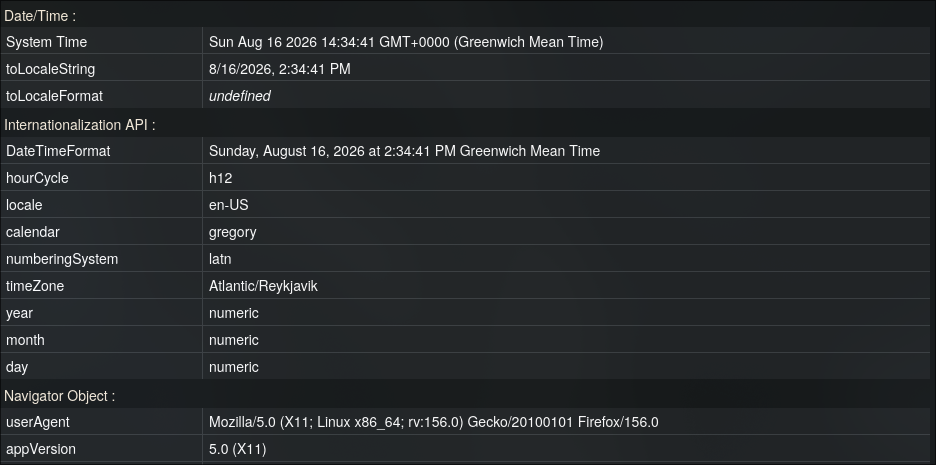
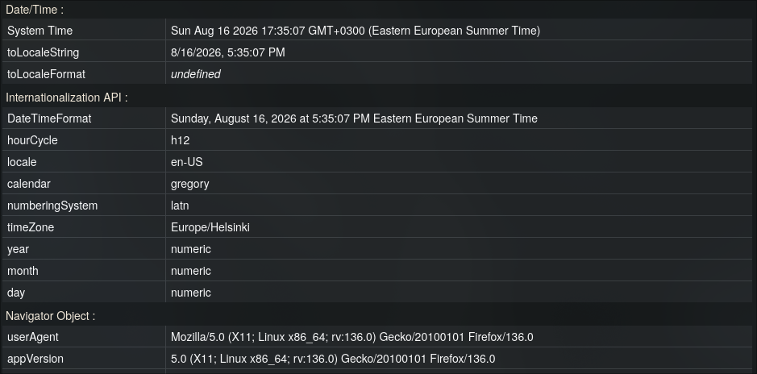
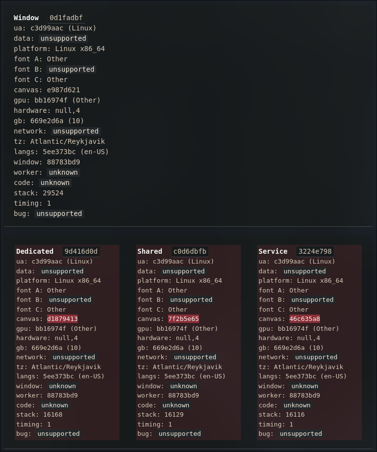
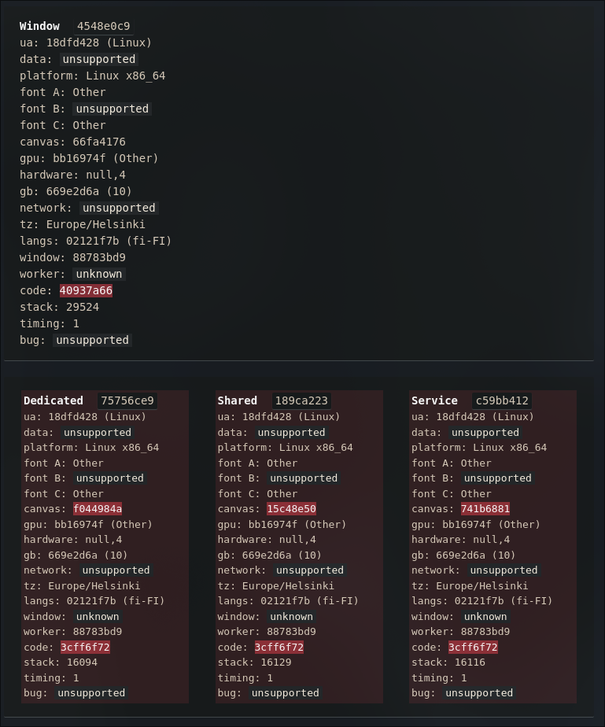

# Timezone Guard

[](https://addons.mozilla.org/addon/timezone-guard/)

*[Читать на русском](ru/README.ru.md)*

A Firefox extension that spoofs the time zone and (optionally) the User-Agent reported by the browser to websites — across all contexts: the main page, iframes (any nesting depth), Dedicated Worker, Shared Worker, and Service Worker.

## Why

Websites infer approximate location and browser characteristics via `Intl.DateTimeFormat`, `Date.prototype.getTimezoneOffset`, `navigator.userAgent`, and similar APIs — and they do this not only in the main window but also inside workers, where ordinary time-zone spoofing extensions usually can't reach. This extension patches all these points consistently, so every context returns the same spoofed values.

## Features

- Time zone spoofing (`Intl.DateTimeFormat`, `Date.prototype.getTimezoneOffset`, `toString` / `toDateString` / `toTimeString` / `toLocaleString` / `toLocaleDateString` / `toLocaleTimeString`)
- Optional User-Agent spoofing (`navigator.userAgent`, `appVersion`, `platform`, `vendor`, `language(s)`, `userAgentData` for Chrome-like UAs)
- Works consistently in: main window, iframe (including nested iframe-within-iframe), Dedicated Worker, Shared Worker, Service Worker
- Real system clock and `Date.now()` are left untouched — only how the date is *interpreted and displayed* in the chosen time zone is changed
- Cached `Intl.DateTimeFormat` formatters — the spoof does not introduce noticeable delay compared to native behavior (important against timing detectors like CreepJS)
- Works on sites with strict Content-Security-Policy (Spotify Web Player and similar) — the patch is injected declaratively via `world: "MAIN"`, not through a `<script>` tag in the DOM
- No new properties on `window` — all shared state lives inside the closure of a single file and is not enumerable from the outside

## How it works

### Main page and iframes — `spoof/main.js`

A single content script injected by the browser directly into the page's main world (`world: "MAIN"` in the manifest, rather than via `document.createElement('script')` — this is the only way to bypass the page's CSP, since such injection is not treated as code added by the page itself).

- `Intl.DateTimeFormat` and `Date.prototype` methods are patched once per window, with cached formatters (no re-creating `Intl.DateTimeFormat` on every call — otherwise detectors flag the spoof by execution timing).
- `navigator.userAgent` and related properties are patched via `Object.defineProperty` on `Navigator.prototype`.
- All patched functions are masked as `[native code]` via a custom `toString` wrapper.
- **iframe**: instead of `MutationObserver` (which is always asynchronous and can't fire before synchronous code reads `iframe.contentWindow` in the same tick), the getter `contentWindow` / `contentDocument` on `HTMLIFrameElement.prototype` is patched — the spoof is applied at the moment of access, not at the moment the element is inserted into the DOM. The patch is recursively applied to `HTMLIFrameElement.prototype` inside every patched window, so iframe-within-iframe also works.
- **Dedicated / Shared Worker**: the `Worker` / `SharedWorker` constructors are wrapped so that our patch runs before the worker's original script, and the original file itself is loaded from inside the worker via `importScripts()` — without a blocking synchronous XHR on the main thread (which would otherwise produce a noticeable timing signal).
- **Service Worker**: `navigator.serviceWorker.register()` is intercepted to learn the exact URL of the worker script — this information is sent to the background via `bridge.js`.

### `bridge.js` (isolated world)

Reads the saved `tz` / `ua` from `browser.storage.local` and passes them to `main.js` through a temporary DOM attribute on `<html>` (immediately removed after reading) — this is the only CSP-safe way to transfer data between the isolated and main worlds without injecting a `<script>` tag.

### `background/background.js` + `background/build_worker.js`

A Service Worker cannot be patched the same way as a Dedicated / Shared Worker — the specification requires the registration URL to be a plain `http(s)`; `blob:` is forbidden at the browser level. Therefore a network-response interception is used here:

- `webRequest.onBeforeRequest` + `webRequest.filterResponseData` (requires the `webRequestFilterResponse.serviceWorkerScript` permission) splices the patch code into the beginning of the response body for the Service Worker script, before the browser parses it.
- The filter must be installed in `onBeforeRequest`, not later (`onHeadersReceived`) — otherwise you may be too late and hit Firefox's internal optimized script byte-cache (`Invalid request ID`).
- The URL of the registering SW script is determined from the message sent by `main.js` / `bridge.js` (intercepting `register()`), not from the `Service-Worker: script` header — the header is not always visible to extensions in all browser builds.

## Installation (development / temporary extension)

1. `about:debugging#/runtime/this-firefox` → **Load Temporary Add-on** → select `manifest.json`.
2. Open the popup, choose a time zone (and optionally a User-Agent), **Save & Apply**.
3. Fully close and reopen the tab (not just F5 — temporary extensions in Firefox get a new `moz-extension://` UUID on every reload, and old tabs may reference a now-invalid address).

## Project structure

```
manifest.json
bridge.js                     — isolated world: reads storage, passes tz/ua via DOM attribute
spoof/
  main.js                     — all patches (Intl/Date/UA/iframe/Worker/SharedWorker), one file, one IIFE
background/
  background.js                — network response interception and patching
  build_worker.js               — patch-code generator for workers (module, used by background.js)
frontend/
  popup.html
  popup.js
icons/
```

## Permissions

- `storage` — saves the selected tz/ua locally
- `<all_urls>` (host permission) — the spoof must apply on any site, before the site's own scripts run
- `webRequest`, `webRequestBlocking`, `webRequestFilterResponse`, `webRequestFilterResponse.serviceWorkerScript` — required exclusively for patching the Service Worker via network response interception

## Known limitations

- **Indexed access `window[n]` / `window.frames[n]`** — accessing a child browsing context by numeric index is exotic internal behavior of `WindowProxy` at the engine level, not an ordinary JS property. `Object.defineProperty` cannot intercept it (unlike `contentWindow`, which is an ordinary accessor property of the prototype). The first such access returns real data; subsequent accesses through `.contentWindow` are already patched.
- **"Dead" (detached) iframes** — a reference to a `window` of an iframe removed from the DOM, obtained through a non-standard access path, may remain unpatched.
- After changing tz/ua in the popup, open tabs must be reloaded — the spoof is applied at page load time, not retroactively in real time (although an already open tab will pick up the new value "live" for future API calls if the popup was opened before the page reload).
- The extension only changes what is *reported* through JS APIs — the operating system clock and time zone are not touched.

## Comparison (Before / After)

| Before (Original) | After (Spoofed) |
| :---: | :---: |
|  |  |
|  |  |

## License

MIT