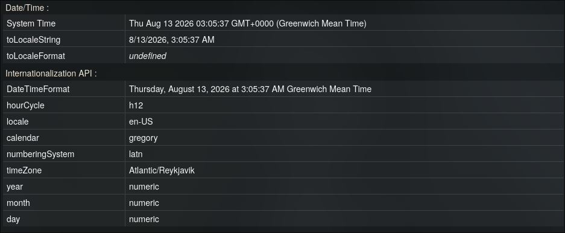
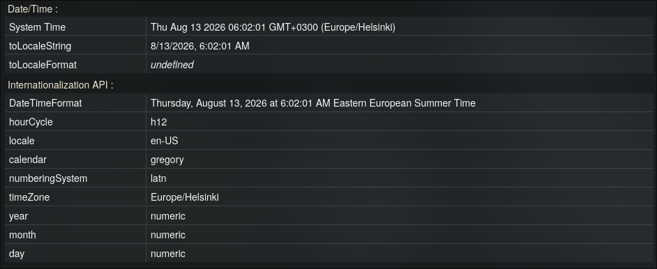

# Timezone Guard

*[Read in English](README.md)*

Лёгкое расширение для Firefox, которое подменяет часовой пояс, который браузер сообщает сайтам, защищая от фингерпринтинга по таймзоне.

## Зачем это нужно

Многие сайты определяют ваш часовой пояс через JavaScript API (`Intl.DateTimeFormat`, `Date.prototype.getTimezoneOffset` и т.д.), чтобы примерно вычислить ваше местоположение — даже если вы используете VPN. Timezone Guard перехватывает эти API и сообщает сайтам выбранный вами часовой пояс вместо реального, при этом все подменённые значения остаются согласованными между собой (смещение, отформатированные строки даты/времени и `Intl.DateTimeFormat().resolvedOptions().timeZone` совпадают друг с другом).

По смыслу это похоже на встроенную в Firefox настройку `privacy.resistFingerprinting`, но позволяет самому выбрать нужный часовой пояс, а не всегда получать один и тот же фиксированный.

## Возможности

- Выбор часового пояса из списка прямо в попапе расширения
- Подмена `Intl.DateTimeFormat`, `Date.prototype.getTimezoneOffset`, а также `Date.prototype.toString` / `toDateString` / `toTimeString` / `toLocaleString` / `toLocaleDateString` / `toLocaleTimeString`
- Работает как на самой странице, так и во всех вложенных iframe, включая те, что добавляются на страницу динамически после её загрузки
- Всё выполняется полностью локально — никакие данные никуда не собираются и не передаются
- Реальные системные часы и timestamp `Date.now()` не трогаются — меняется только то, как дата *интерпретируется и отображается* в выбранном часовом поясе, поэтому страницы, зависящие от реального течения времени, продолжают работать корректно
- Проверено на YouTube — воспроизведение, прямые трансляции и таймстампы в комментариях не ломаются
- Совместимо со встроенной в Firefox настройкой `privacy.resistFingerprinting` — можно использовать оба варианта одновременно без конфликтов
- Работает на сайтах со строгим Content-Security-Policy (например, Spotify Web Player) — скрипт подмены инжектится напрямую в main world страницы самим браузером, а не через вставку `<script>` в DOM, поэтому не подпадает под правила `script-src` из CSP страницы

## Как это работает

Сайты со строгим Content-Security-Policy блокируют инлайн-скрипты, вставленные через `document.createElement('script')` — именно так многие расширения для подмены часового пояса (включая более ранние версии этого) инжектят свой патч. Чтобы это надёжно работало везде, Timezone Guard разбивает задачу на два content script'а:

1. **`bridge.js`** выполняется в *изолированном мире* на этапе `document_start`. У него есть доступ к `browser.storage.local`, он читает сохранённый часовой пояс и записывает его в атрибут `data-tz-guard` на `<html>` (сразу подставляя значение по умолчанию, чтобы ничего не приходилось ждать асинхронного чтения из storage).
2. **`spoof.js`** выполняется в *main world* самой страницы на этапе `document_start`, объявленный прямо в manifest с `"world": "MAIN"`. Поскольку скрипт инжектит сам браузер, а не страница через DOM, он полностью обходит CSP страницы. Он считывает значение часового пояса, которое `bridge.js` записал в DOM-атрибут, и подменяет нужные методы `Intl`/`Date` на `window` — а также на `window` каждого iframe, отслеживаемого через `MutationObserver`.

## Установка (разработка / временное расширение)

1. Откройте `about:debugging#/runtime/this-firefox` в Firefox.
2. Нажмите **Load Temporary Add-on**.
3. Выберите файл `manifest.json` из этого репозитория.
4. Откройте попап расширения, выберите часовой пояс, нажмите **Apply**, затем перезагрузите открытые вкладки.

## Структура проекта

```
manifest.json
bridge.js           — скрипт изолированного мира: читает storage, передаёт часовой пояс на страницу через атрибут DOM
spoof.js             — скрипт main world: подменяет Intl/Date, обходит CSP страницы
popup.html           — интерфейс попапа
popup.js             — чтение/запись выбранного часового пояса в storage
icons/               — иконки расширения (16/32/48/128 px)
```

## Ограничения

- После смены часового пояса в попапе открытые вкладки нужно перезагрузить — подмена применяется один раз при загрузке страницы, а не в реальном времени.
- Расширение влияет только на *сообщаемый* часовой пояс в JavaScript API. Оно не меняет часовой пояс или время в самой операционной системе.
- Некоторые скрипты фингерпринтинга могут сверяться с другими признаками (например, `Intl.NumberFormat`, раскладка клавиатуры, `navigator.language`), которые это расширение сейчас не подменяет.
- Декларативный `"world": "MAIN"` content script требует достаточно свежей версии Firefox/Chromium.

## Сравнение (До / После)

| До (Оригинал) | После (Подмена) |
| :---: | :---: |
|  |  |

## Лицензия

MIT