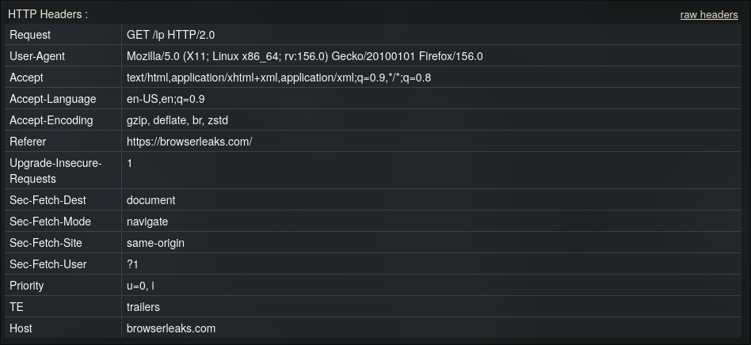
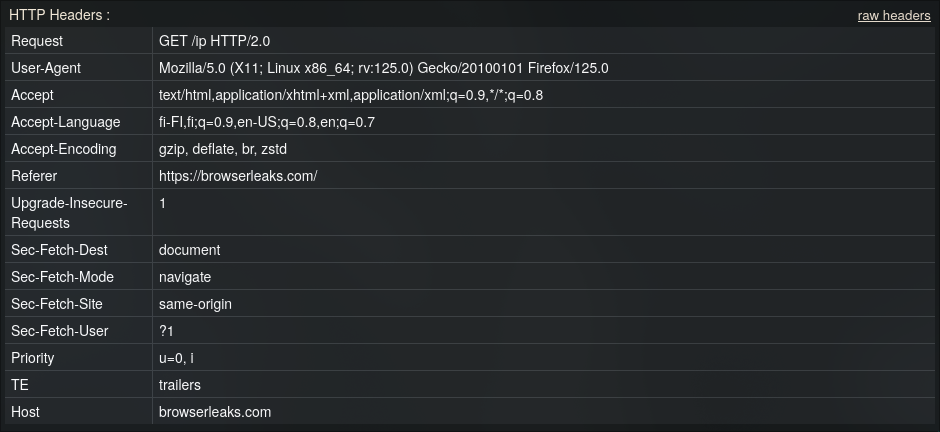
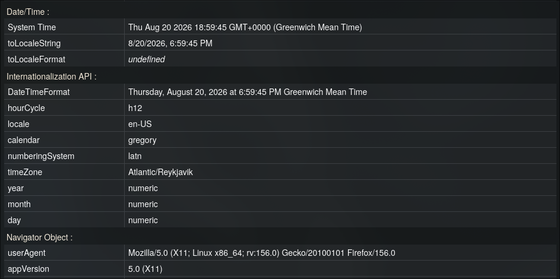
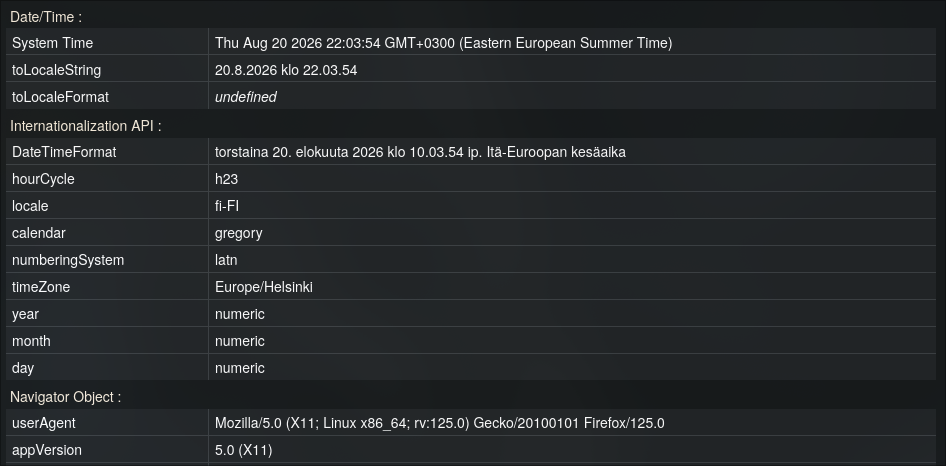
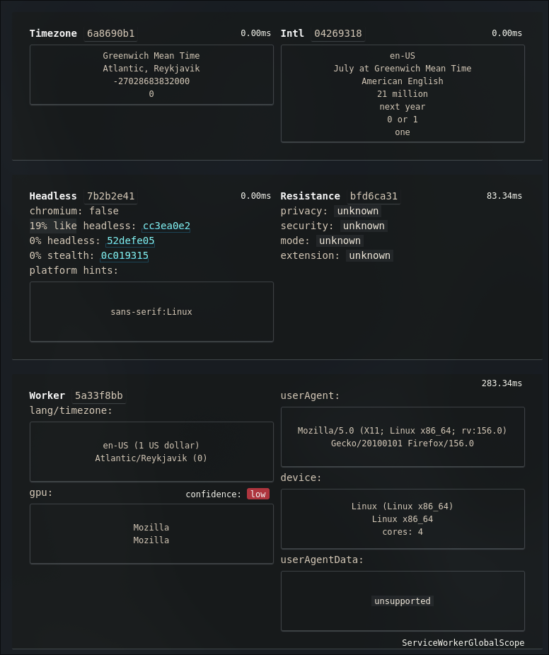
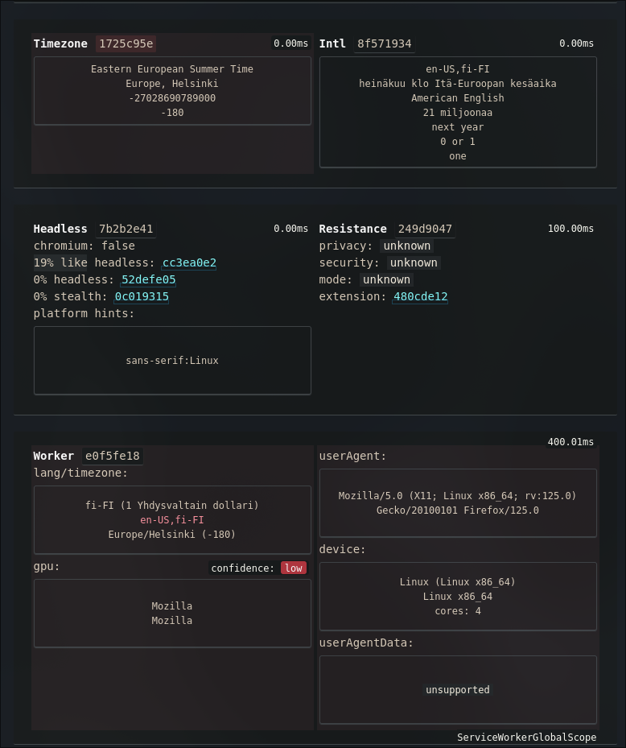
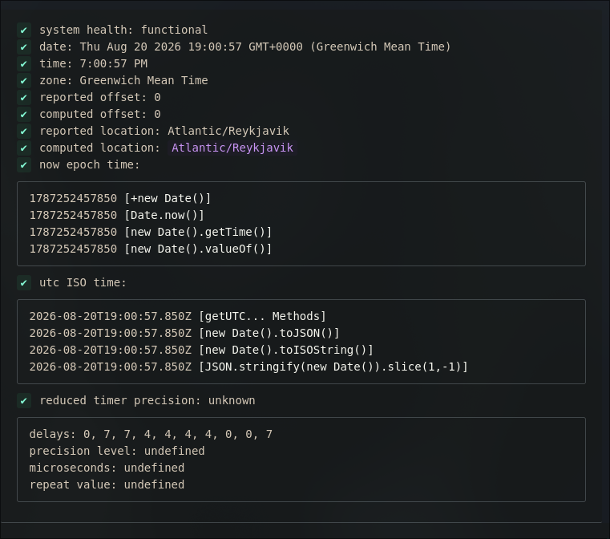
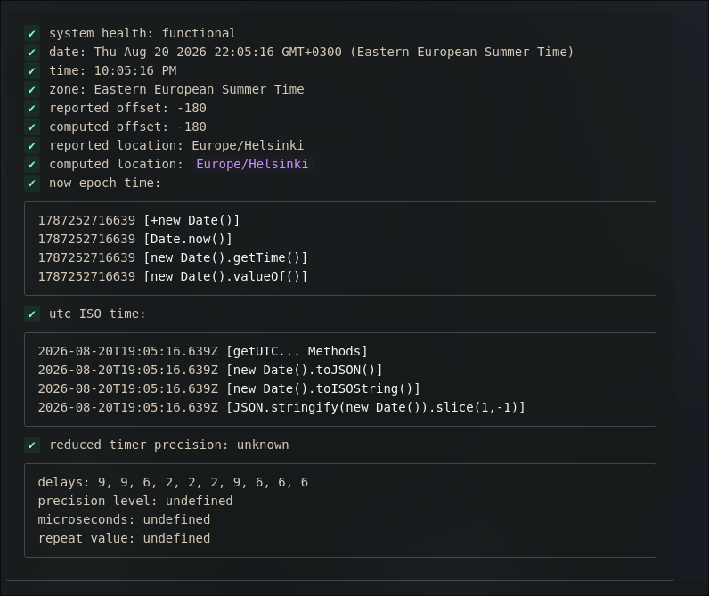
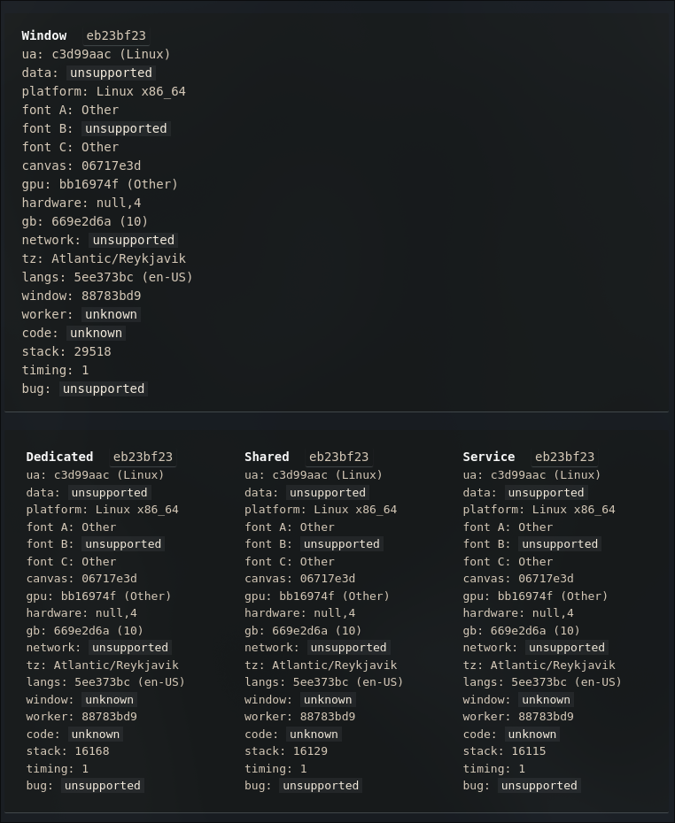
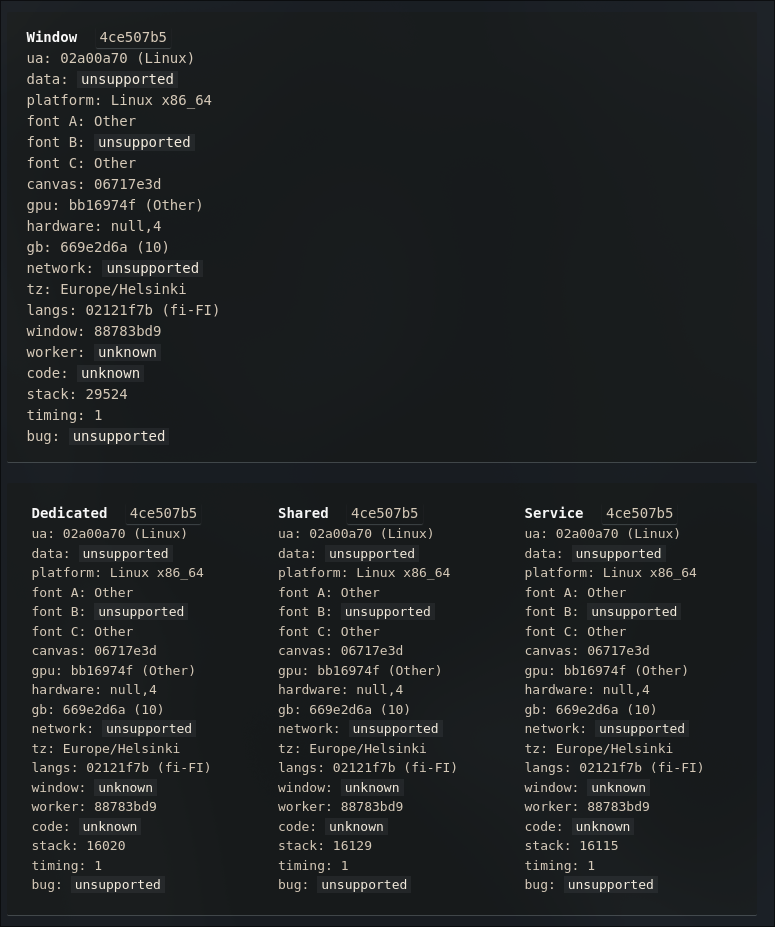

# Timezone Guard

[](https://addons.mozilla.org/addon/timezone-guard/)

*[Read in English](../README.md)*

Расширение для Firefox, которое подменяет часовой пояс и (опционально) User-Agent, которые браузер сообщает сайтам — во всех контекстах: главной странице, iframe (любой глубины вложенности), Dedicated Worker, Shared Worker и Service Worker.

## Зачем

Сайты вычисляют примерное местоположение и характеристики браузера через `Intl.DateTimeFormat`, `Date.prototype.getTimezoneOffset`, `navigator.userAgent` и похожие API — причём делают это не только в основном окне, но и внутри воркеров, куда обычные расширения для подмены таймзоны обычно не добираются. Это расширение патчит все эти точки согласованно, так что во всех контекстах отдаётся один и тот же результат.

## Возможности

- **Подмена часового пояса** — `Intl.DateTimeFormat`, `Date.prototype.getTimezoneOffset`, `toString`/`toDateString`/`toTimeString`/`toLocaleString`/`toLocaleDateString`/`toLocaleTimeString`
- **Опциональная подмена User-Agent** — `navigator.userAgent`, `appVersion`, `platform`, `vendor`, `language`, `languages`, `maxTouchPoints`, `oscpu` (Firefox) и связанные свойства
- **Подмена HTTP-заголовков** — опционально изменяет исходящие заголовки `Accept-Language` и `User-Agent` в соответствии с выбранным часовым поясом и браузером
- **Исключения сайтов** — спуф включён везде по умолчанию; сайты из списка (один домен в строке в попапе, поддомены учитываются) — *исключения*: на них окружение остаётся полностью нативным — ничего не оборачивается и не изменяется. Пустой список — спуф везде, как раньше
- **Работает согласованно в** — главном окне, iframe (включая вложенные iframe-в-iframe и `about:blank`/`srcdoc`), Dedicated Worker, Shared Worker, Service Worker
- **Согласованная локаль** — локаль по умолчанию во всех Intl-API (`DateTimeFormat`, `NumberFormat`, `Collator`, `DisplayNames`, `PluralRules`, `ListFormat`, `RelativeTimeFormat`) приводится к языку выбранного часового пояса; глобальный объект `Date` проходит натив-чеки (`toString`, `name`, `length`)
- **Реальные системные часы не трогаются** — `Date.now()` и системные часы ОС не изменяются; меняется только то, как дата *интерпретируется и отображается* в выбранной таймзоне
- **Кэшированные форматтеры** — `Intl.DateTimeFormat` и `Intl.NumberFormat` создаются один раз и переиспользуются, чтобы не создавать заметных задержек (важно против timing-детекторов вроде CreepJS)
- **Работает со строгим CSP** — патч инжектится декларативно через `world: "MAIN"`, обходя Content-Security-Policy (Spotify Web Player и подобные)
- **Ни одного нового свойства на `window`** — всё общее состояние живёт в замыкании одного файла, снаружи не enumerable
- **Поддержка Temporal API** — патчит `Temporal.Now.timeZoneId` и связанные методы, если API доступно
- **Подмена формата чисел** — `Intl.NumberFormat` и `Number.prototype.toLocaleString` используют подменённую локаль

## Как это устроено

### Основная страница и iframe — `spoof/main.js`

Единый content script, инжектируемый браузером напрямую в main world страницы (`world: "MAIN"` в манифесте). Такая инжекция не считается кодом, добавленным самой страницей, поэтому обходит CSP.

- `Intl.DateTimeFormat`, `Intl.NumberFormat` и методы `Date.prototype` патчатся один раз на окно, с кэшированными форматтерами.
- `navigator.userAgent` и связанные свойства патчатся через `Object.defineProperty` на `Navigator.prototype`.
- Все патченные функции маскируются под `[native code]` через кастомный `toString`.
- **iframe**: вместо `MutationObserver` (который всегда асинхронный) патчится сам геттер `contentWindow`/`contentDocument` на `HTMLIFrameElement.prototype` — подмена применяется в момент обращения, а не в момент вставки элемента в DOM. Рекурсивный патч работает и для iframe-в-iframe.
- **Dedicated/Shared Worker**: конструкторы `Worker`/`SharedWorker` оборачиваются так, чтобы перед оригинальным скриптом воркера выполнялся наш патч, а сам оригинальный файл подгружается изнутри воркера через `importScripts()` — без блокирующего синхронного XHR на главном потоке.
- **Service Worker**: `navigator.serviceWorker.register()` перехватывается, чтобы узнать точный URL скрипта воркера — эта информация уходит в background через `bridge.js`.

### `bridge.js` (isolated world)

Читает сохранённые `tz`/`ua`/`enabled`/`spoofHeaders` из `browser.storage.local` и передаёт их в `main.js` тремя способами:
1. **DOM-атрибуты** на `<html>` — доступны синхронно при `document_start`.
2. **`sessionStorage` / `localStorage`** (`__tzGuardConfig`) — резервный вариант, переживает перезагрузки страницы и восстановление из bfcache.
3. **`CustomEvent`** (`tz-guard-update-config`) — для живого обновления настроек без перезагрузки.

### `background/background.js` + `background/build_worker.js`

Service Worker нельзя пропатчить через `blob:` URL — спецификация требует обычный `http(s)`. Поэтому используется перехват сетевого ответа:

- `webRequest.onBeforeRequest` + `webRequest.filterResponseData` (требует permission `webRequestFilterResponse.serviceWorkerScript`) вклинивает патч-код в начало тела ответа на скрипт SW.
- Фильтр обязательно ставится в `onBeforeRequest`, а не позже — иначе можно опоздать и наткнуться на внутренний байт-кэш скриптов Firefox (`Invalid request ID`).
- URL зарегистрированных Service Worker'ов сохраняются в `storage.local` (`swUrls`), чтобы подмена работала после перезапуска браузера.

### Подмена HTTP-заголовков

Когда в попапе включён переключатель **"Spoof HTTP Headers"`, расширение через `webRequest.onBeforeSendHeaders` изменяет исходящие заголовки:
- **`Accept-Language`** — один языковой тег, выведенный из языка выбранного часового пояса (например, `Europe/Moscow` → `ru-RU`), в точности совпадающий с подменённым `navigator.languages`
- **`User-Agent`** — подменяется на кастомный, если задан.

### Исключения сайтов

Список исключений проверяется на всех уровнях — сайт из списка не может увидеть ни следа расширения, а все остальные сайты спуфятся как обычно:

- **background** — rewriting заголовков и инжекция патча в Service Worker пропускаются для сайтов из списка исключений (`isSiteAllowed` / `requestPageUrl`);
- **per frame** — `bridge.js` резолвит hostname каждого фрейма (включая `about:blank`/`srcdoc`, которые наследуют origin родителя) и решает независимо;
- **main world** — `spoof/main.js` синхронно читает пер-сайт-кэш конфига на `document_start`; если хост — сайт из списка исключений, обёртки не ставятся вовсе — даже конструкторы `Worker`/`SharedWorker` остаются нативными. На исключениях `bridge.js` также ничего не пишет в `sessionStorage`/`localStorage` страницы, не ставит атрибуты на `<html>` и не дёргает кастомные события — ноль следов в странице.

**Правило наследования** — статус исключения распространяется на всё, что сайт заспавнил:

- **Встроенные им фреймы** автоматически наследуют исключение (например, iframe капчи Cloudflare `challenges.cloudflare.com` внутри сайта-исключения `ip.cx` остаётся нативным — вручную его вносить не нужно). Для кросс-доменных предков используется `location.href` — единственное свойство location, читаемое кросс-доменно по спецификации, — из него извлекается hostname, так что странице ничего нового не открывается;
- **Сетевые запросы** (заголовки, патчинг Service Worker) тоже пропускаются, если хоть один предок в цепочке origin запроса — содержащий документ, инициатор или любой родительский фрейм — является сайтом-исключением. Фоновой скрипт восстанавливает цепочку фреймов каждого запроса из пер-вкладочного реестра.

Прямые поддомены (`*.example.com`) матчятся всегда; посторонние сайты не затрагиваются.

Правило сопоставления (идентично во всех копиях): lowercase, обрезаются схема/путь/порт, домен `example.com` матчит и сам `example.com`, и любые `*.example.com` поддомены.

## Настройки в попапе

- **Extension Enabled** — главный переключатель; при выключении отключает всю подмену.
- **Spoof HTTP Headers** — включает/выключает модификацию исходящих заголовков `Accept-Language` и `User-Agent`.
- **Timezone** — выбор часового пояса для подмены.
- **User-Agent** — выбор из пресетов или ручной ввод строки.
- **Site Exceptions** — один домен в строке; каждый сайт из списка (и его поддомены) остаётся полностью нативным; пустой список = спуф везде.

## Установка (разработка / временное расширение)

1. `about:debugging#/runtime/this-firefox` → **Load Temporary Add-on** → выбрать `manifest.json`.
2. Открыть попап, выбрать часовой пояс (и опционально User-Agent), настроить переключатели, нажать **Save & Apply**.
3. Полностью закрыть и заново открыть вкладку (не просто F5 — временные расширения в Firefox получают новый `moz-extension://` UUID при каждой перезагрузке).

## Структура проекта

```
manifest.json
bridge.js                     — isolated world: читает storage, передаёт конфиг через DOM + storage events
spoof/
  main.js                     — весь патч (Intl/Date/UA/iframe/Worker/SharedWorker/Temporal), один файл, один IIFE
background/
  background.js                — перехват и патч сетевого ответа SW, подмена заголовков, трекинг URL SW
  build_worker.js               — генератор патч-кода для внедрения в Service Worker (модуль)
frontend/
  popup.html
  popup.js
icons/
```

## Permissions

- `storage` — сохранение выбранных настроек локально; хранение известных URL Service Worker'ов.
- `<all_urls>` (host permission) — подмена должна применяться на любом сайте, до выполнения его собственных скриптов.
- `webRequest`, `webRequestBlocking`, `webRequestFilterResponse`, `webRequestFilterResponse.serviceWorkerScript` — нужны для патчинга Service Worker через перехват сетевого ответа и для модификации HTTP-заголовков.

## Известные ограничения

- **Индексный доступ `window[n]` / `window.frames[n]`** — обращение к дочернему browsing context по числовому индексу является exotic internal-поведением `WindowProxy` на уровне движка браузера, а не обычным JS-свойством. `Object.defineProperty` не может это перехватить. Первое такое обращение отдаёт реальные данные; последующие через `.contentWindow` уже патчены.
- **"Мёртвые" (detached) iframe** — ссылка на `window` удалённого из DOM iframe, полученная через нестандартный путь доступа, может остаться непропатченной.
- **Живое обновление требует перезагрузки** — после смены tz/ua в попапе открытые вкладки нужно перезагружать. Подмена применяется при загрузке страницы, а не в реальном времени задним числом (хотя уже открытая вкладка подхватит новое значение для будущих вызовов API, если попап был открыт до перезагрузки страницы).
- **Живые изменения настроек** — изменения настроек рассылаются живо по открытым вкладкам. Выключение расширения (тумблер или добавление сайта в исключения) полностью разворачивает все уже установленные патчи — страница возвращается в pristine-нативное состояние без перезагрузки. Включение и прочие изменения применяются в момент прихода события; перезагрузка вкладки по-прежнему гарантированный способ начать страницу сразу в новом состоянии.
- **Часы ОС не трогаются** — расширение меняет только то, что *сообщается* через JS API и HTTP-заголовки. Часы и часовой пояс операционной системы не изменяются.

## Сравнение (до / после)

| | До | После |
|---|---|---|
| **BrowserLeaks — HTTP-заголовки** |  |  |
| **BrowserLeaks — JS API** |  |  |
| **CreepJS — Фингерпринт** |  |  |
| **CreepJS — Таймзона** |  |  |
| **CreepJS — Воркеры** |  |  |

## Лицензия

MIT
